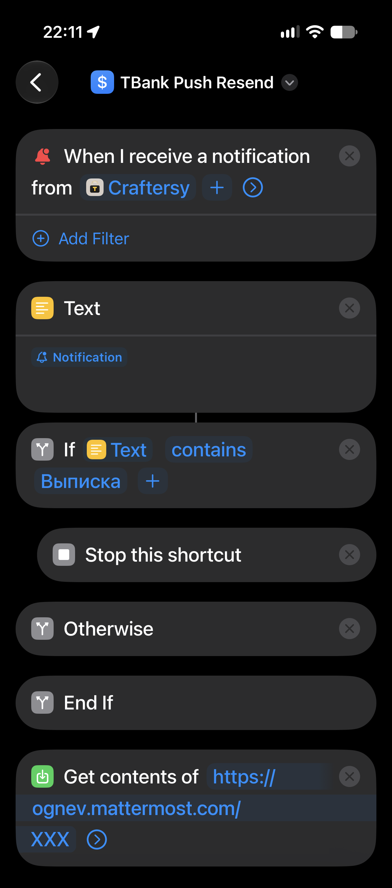

# Обработка платежей ТБанка

Хочу настроить автоматическую обработку платежей с Тинька через робота. Но к сожалению, у жёлтого банка нет API или автоматической отправки выписки. 

Но у пользователей яблочных телефонов есть возможность настроить автоматизацию через Shortcuts, которая будет пуши (кстати, любых приложений) пересылать куда угодно. В моём случае - пуш от ТБанка пересылается в мой маттермост, где сообщение попадает в нужный мне канал и там его подхватывает автоматика: кладёт в гугл-табличку с моими домашними доходами/расходами.

Прикладываю как эта штука выглядит в настроенном виде + md-файлик с инструкцией для вашего ЧатаГПТ/Клавдии.

Инструкция для ИИ-ассистента: [shortcut-setup.md](shortcut-setup.md)
